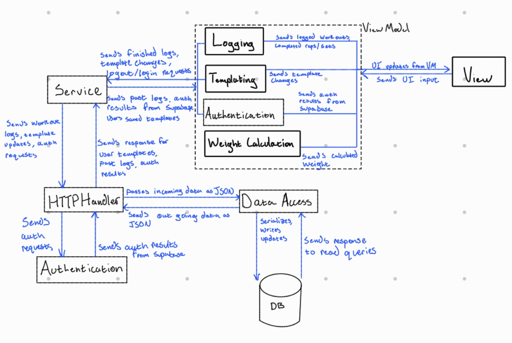
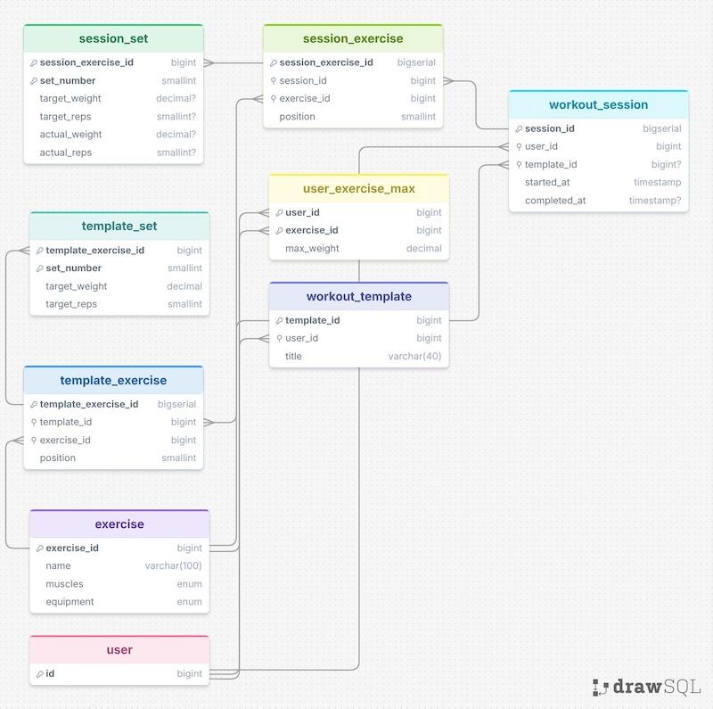

# LibreLift - Design Document

|                  |                                                                                                                                                           |
| ---------------- | --------------------------------------------------------------------------------------------------------------------------------------------------------- |
| **Authors**      | James Teuscher                                                                                                                                            |
| **Reviewers**    | [who reviewed it — a teammate, the instructor, a design-review partner]                                                                                   |
| **Status**       | In review                                                                                                                                                 |
| **Last updated** | 10-21-26                                                                                                                                                  |
| **Links**        | [proposal](../cp3/cp3-proposal) · [repository](https://github.com/LibreLift/expo_suite) · [issue tracker](https://github.com/LibreLift/expo_suite/issues) |

## Revision history

| Date     | Author         | What changed        |
| -------- | -------------- | ------------------- |
| 10-16-26 | James Teuscher | First draft         |
| 10-20-26 | James Teuscher | First full draft    |
| 10-21-26 | James Teuscher | Finished first copy |

---

## 1. Context and scope

LibreLift is a native mobile app for planning, logging, and tracking workouts for those who want to use their phones to do so. It aims to provide the basic functions of creating reusable workout templates, using a template for a workout and logging reps and weight, and reviewing the details of past workouts. For more information about the context of this project, see the [proposal document](../cp3/cp3-proposal).

## 2. Goals and non-goals

**Goals**

- Connect to RepDB, an external exercise DB, and load the catalog of ~500 free exercises into the app for use. Besides name, the exercises in the app should be identifiable by target muscles and equipment.
- Support creation, persistence, editing, and deletion of reusable exercise templates.
- Support starting, stopping, and completing workout sessions for an existing template. Workout session allow logging repetitions performed and weight used for each exercise in a plan.
- Support storing "one-rep" maximum weight for certain exercises, and enter weight in template exercises as a percentage of that maximum.

**Non-goals**

- Social exercising features such as followers/friends, sharing workouts, leaving comments, etc., are excluded. They fall outside the scope of primary user needs.
- No body composition and fitness goal customization. 

## 3. System-context diagram

There will only be one type of user interacting with this system. They will create plans and log workouts. The other external component interacting with this system is the CDN/API that provides a catalog of exercises. It will interact with the system by providing the exercise catalog via HTTP.

## 4. Architecture and components

| Component      | Responsibility                                                                   | Talks to                            | Interface (rough)                     |
| -------------- | -------------------------------------------------------------------------------- | ----------------------------------- | ------------------------------------- |
| View           | Displays UI and accepts user input                                               | ViewModel                           | function calls, touch screen elements |
| ViewModel      | Business logic of logging, templating, and weight calculation                    | View, Service                       | function calls                        |
| Service        | Makes calls to backend to read/write data for ViewModel operations               | ViewModel, HTTPHandlers             | function calls, HTTP                  |
| HTTPHandlers   | Accepts incoming HTTP calls from frontend, handles request payloads              | Service, DataAccess, Authentication | function calls, HTTP                  |
| Authentication | Accepts authentication requests via HTTP, uses Supabase auth to accept or reject | HTTPHandler                         | function calls, HTTP                  |
| DataAccess     | Adjusts HTTP payloads to be ready for DB reads/writes                            | DB, HTTPHandlers                    | function calls, HTTP                  |
| DB             | Stores data persistently, supplies data for app UI                               | DataAccess                          | HTTP                                  |

### Core flow - Making a workout template

1. A user logs in or signs up with credentials
2. User taps the screen to create a plan
3. View layer sends input to ViewModel
4. ViewModel navigates to template creator business logic, calls service to load catalog
5. Service calls the Exercise CDN to load catalog, returns data to ViewModel
6. ViewModel sends exercises to View
7. View displays exercises
8. User chooses exercises, weight, reps
9. View sends selections to ViewModel
10. ViewModel saves plan in-memory as user builds template
11. User taps "Save plan"
12. View call ViewModel's save function
13. ViewModel sends plan data to service via function call
14. Service serializes the plan into JSON, calls backend via HTTP
15. HTTPHandler receives plan JSON, passes to DataAccess layer via function call
16. DataAccess layer deserializes JSON, writes to DB via HTTP 

### The failure case

1. User taps the screen to create a plan
2. View layer sends input to ViewModel
3. ViewModel navigates to template creator business logic, calls service to load catalog
4. Service checks if the catalog is cached. If not, call the Service layer
5. Service calls the Exercise CDN to load catalog, returns data to ViewModel
6. CDN throws an error and does not return catalog
7. Service passes an error to the ViewModel layer
8. ViewModel layer formats the error message to display on the UI
9. UI displays the error message for the User, asks to wait for a period and then try again

### Core flow - Logging a workout:

1. A user logs in using credentials
2. User selects one of their templates and taps  a "Start workout" button.
3. A stopwatch/counter displays workout duration, and lists the exercises in the workout.
4. For each exercise, the user is able to tap it and see a detailed view 
5. The user can adjust actual weight and reps used if it differs from the templated amounts
6. After doing a one round of exercises, the user clicks complete, and the next round is presented.
7. This is repeated for all the templated amount of rounds, for each exercise.
8. When finished, the user taps "Finish workout"
9. The workout is completed and added to the User's log
10. The user can navigate to a history/log screen and see the details of their session

### The failure case

1. A user logs in using credentials
2. User selects one of their templates and taps  a "Start workout" button.
3. The user proceeds through the workout as stated above
4. When tapping the "Finish workout" button, the DB write fails
5. The error message is sent back to the user and told to try again in a few minutes.
6. If the error persists a second time, the user is presented a button to send feedback.
7. The feedback link sends an email to the maintainers with the user input.

## 5. Data model

| Entity            | Key fields                                                                             | Relationships                                                             | MVP or roadmap |
| ----------------- | -------------------------------------------------------------------------------------- | ------------------------------------------------------------------------- | -------------- |
| User              | id                                                                                     | has workout templates, has workout sessions, and has exercise max weights | MVP            |
| Exercise          | exercise_id, name, muscles, equipmenet                                                 | has a User max weight, part of template exercise and session exercise     | MVP            |
| Workout template  | userId, template_id, title                                                             | belongs to User, has exercises, fills a workout session                   | MVP            |
| Template exercise | template_exercise_id, exercise_id, template_id, position                               | part of Workout template, is an exercise, has sets                        | MVP            |
| Template set      | template_exercise_id, set_number, target_weight, target_reps                           | part of Template exercise                                                 | MVP            |
| User exercise max | user_id, exercise_id, max_weight                                                       | belongs to User, describes exercise                                       | MVP            |
| Workout session   | session_id, user_id, template_id, started_at, completed_at                             | belongs to user, filled by workout template, contains session exercises   | MVP            |
| Session exercise  | session_exercise_id, session_id, exercise_id, position                                 | part of Workout session, has session sets                                 | MVP            |
| Session sets      | sesson_exercise_id, set_number, target_weight, target_reps, actual_weight, actual_reps | part of session workout                                                   | MVP            |

**ERD:**

## 6. Technology choices and alternatives considered

### Decision: What ExerciseDB/CDN will be used

- **Chosen:** RepDB
- **Alternative considered:** yuhonas/free-exercise-db
- **Why the chosen option wins, given our goals:** There is a free starter license, and the example images are superior than those in free-exercise-db
- **Evidence:** The spike utilized RepDB, while a personal side project has utilized free-exercise-db, and the RepDB images are superior, while muscle grouping, exercises available, and instructions are roughly equivalent.
- **What would change our mind:** If the user base grows enough that the RepDB free license is no longer usable, I would want to switch to the free alternative of free-exercise-db
### Decision: What DBMS will be used to store user data

- **Chosen**: PostgreSQL
- **Alternative considered:** SQLite
- **Why the chosen option wins, given our goals**: PostgreSQL is better for larger applications that will be deployed. It is also provided with Supabase, which is the backend computing service that will be used.
- **Evidence**: The client-server model of Postgres natively supports more traffic than the file-based model of SQLite. Also, the [Supabase docs](https://supabase.com/docs/guides/database/overview) detail why Postgres is supported for their services.
- **What would change our mind:** Frankly, there isn't anything that would change my mind from Postgres to SQLite, but potentially if the data access layer becomes a bottleneck, a NoSQL database would be considered.

## 7. Risks and open questions

| Risk or question                                                                                                         | Why it matters                                                                                                         | Owner | How we'll find out, and by when                                                                          |
| ------------------------------------------------------------------------------------------------------------------------ | ---------------------------------------------------------------------------------------------------------------------- | ----- | -------------------------------------------------------------------------------------------------------- |
| How precisely to represent workout and exercise templates vs workout and exercise sessions/completions in the data model | Doing so inefficiently can erode DB performance, and add unnecessary overhead to the Data Access component             | James | Do research during milestone 1, determine the ideal data model                                           |
| How to provision Supabase Edge functions and DB                                                                          | This is where all of the data storage and backend computing will live. Without this, the app does not provide value.   | James | Read Supabase docs and run through quick starts for DB and Edge functions before starting milestone 3    |
| What method of authentication to use                                                                                     | Poor credential selection can impede user experience, or introduce security overhead (which is not strictly negative.) | James | Determine top 3 credential options and weigh pros and cons. Make a selection before starting milestone 3 |

## 8. Implementation plan

| Milestone | What works when it's done                                                                                              | Depends on |
| --------- | ---------------------------------------------------------------------------------------------------------------------- | ---------- |
| 1         | The app UI has a few basic screens with stubbed data                                                                   | —          |
| 2         | The external exercise catalog loads into the app                                                                       | 1          |
| 3         | User authentication with selected credential method                                                                    | 1          |
| 4         | Workout templates can be created, edited, and deleted, and persist across app sessions                                 | 2,3        |
| 5         | Users can record a "one-rep" maximum for exercises, plan a percentage of that maximum in workout templates             | 4          |
| 6         | Workout templates can be "instantiated" and used in a workout session, logging weights and reps used (saved in-memory) | 5          |
| 7         | Workout sessions can be completed and logged to the database, then viewed in the app.                                  | 6          |

---

## Sign-off

| Reviewer | Role   | Date   | Approved |
| -------- | ------ | ------ | -------- |
| [name]   | [role] | [date] | ☐        |

