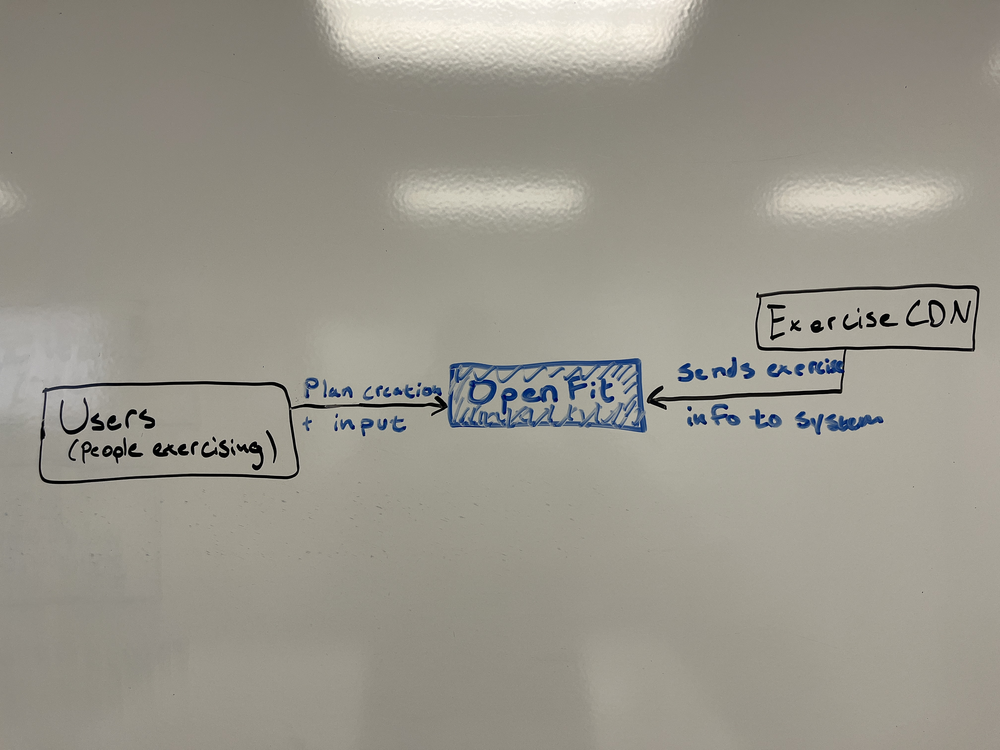

# LibreLift — Design Document

|                  |                                                                         |
| ---------------- | ----------------------------------------------------------------------- |
| **Authors**      | James Teuscher                                                          |
| **Reviewers**    | [who reviewed it — a teammate, the instructor, a design-review partner] |
| **Status**       | Draft                                                                   |
| **Last updated** | 10-16-26                                                                |
| **Links**        | [proposal] · [repository] · [issue tracker]                             |

## Revision history

*A design doc changes as the design does. Record each meaningful revision so a reader can tell what the doc said when a decision was made.*

| Date     | Author         | What changed |
| -------- | -------------- | ------------ |
| 10-16-26 | James Teuscher | First draft  |

---

## 1. Context and scope

*One or two paragraphs. What is being built, for whom, and what landscape it sits in. Link the proposal instead of repeating it — a reader who needs the full argument can follow the link.*

## 2. Goals and non-goals

**Goals** — *what this design must achieve, stated so you could check them:*

- [goal]

**Non-goals** — *things a reasonable reader would expect this system to do, which it deliberately won't. Carry them over from the proposal; here they bound the design.*

- [non-goal]

## 3. System-context diagram

There will only be one type of user interacting with this system. They will create plans and log workouts. The other external component interacting with this system is the CDN/API that provides a catalog of exercises. It will interact with the system by providing the exercise catalog via HTTP.

## 4. Architecture and components

| Component    | Responsibility                                                      | Talks to                | Interface (rough)                     |
| ------------ | ------------------------------------------------------------------- | ----------------------- | ------------------------------------- |
| View         | Displays UI and accepts user input                                  | ViewModel               | function calls, touch screen elements |
| ViewModel    | Business logic of logging, templating, and weight calculation       | View, Service           | function calls                        |
| Service      | Makes calls to backend to read/write data for ViewModel operations  | ViewModel, HTTPHandlers | function calls, HTTP                  |
| HTTPHandlers | Accepts incoming HTTP calls from frontend, handles request payloads | Service, DataAccess     | function calls, HTTP                  |
| DataAccess   | Adjusts HTTP payloads to be ready for DB reads/writes               | DB, HTTPHandlers        | function calls, HTTP                  |
| DB           | Stores data persistently, supplies data for app UI                  | DataAccess              | HTTP                                  |

### Core flow, traced end to end

*The single most important user action in your MVP, step by step through the components above. If the trace needs a component the table doesn't have, the table is wrong.*

1. User taps the screen to create a plan
2. View layer sends input to ViewModel
3. ViewModel navigates to template creator business logic, calls service to load catalog
4. Service calls the Exercise CDN to load catalog, returns data to ViewModel
5. ViewModel sends exercises to View
6. View displays exercises
7. User chooses exercises, weight, reps
8. View sends selections to ViewModel
9. ViewModel saves plan in-memory as user builds template
10. User taps "Save plan"
11. View call ViewModel's save function
12. ViewModel sends plan data to service via function call
13. Service serializes the plan into JSON, calls backend via HTTP
14. HTTPHandler receives plan JSON, passes to DataAccess layer via function call
15. DataAccess layer deserializes JSON, writes to DB via HTTP 

### The failure case

*The same flow when something goes wrong — the network drops, an external service is down, two people act at once. What does the user see, and where does the system recover?*

1. User taps the screen to create a plan
2. View layer sends input to ViewModel
3. ViewModel navigates to template creator business logic, calls service to load catalog
4. Service checks if the catalog is cached. If not, call the Service layer
5. Service calls the Exercise CDN to load catalog, returns data to ViewModel
6. CDN throws an error and does not return catalog
7. Service passes an error to the ViewModel layer
8. ViewModel layer formats the error message to display on the UI
9. UI displays the error message for the User, asks to wait for a period and then try again

## 5. Data model

*Entities, their key fields, and how they relate. Mark what the MVP needs and what only the roadmap needs. Key fields, not every column; no copied schemas.*

| Entity   | Key fields                               | Relationships                  | MVP or roadmap |
| -------- | ---------------------------------------- | ------------------------------ | -------------- |
| User     | id                                       | has Plans, performs Workouts   | MVP            |
| Workout  | userId, workoutId?, exerciseIds?, title? | belongs to User, has exercises | MVP            |
| Exercise | exerciseId, muscles, equipment           | part of Workout                | MVP            |

*Note:* One important distinction that I need to resolve is how to distinguish a template of a workout from a workout that is actively being done or is completed. My initial thought is a supertype of Workout and Exercise, with subtypes/sub-entities, one for a template workout and one for a concrete, logged workout

## 6. Technology choices and alternatives considered

*One block per significant decision. The alternative must be one a reasonable team would actually pick. Where you did real work to decide — a spike, a benchmark, a prototype — cite it; that evidence is the difference between a preference and a decision.*

### Decision: What ExerciseDB/CDN will be used

- **Chosen:** RepDB
- **Alternative considered:** yuhonas/free-exercise-db
- **Why the chosen option wins, given our goals:** There is a free starter license, and the example images are superior than those in free-exercise-db
- **Evidence:** The spike utilized RepDB, while a personal side project has utilized free-exercise-db, and the RepDB images are superior, while muscle grouping, exercises available, and instructions are roughly equivalent.
- **What would change our mind:** If the user base grows enough that the RepDB free license is no longer usable, I would want to switch to the free alternative of free-exercise-db

## 7. Risks and open questions

*What you don't know yet, stated honestly. Each open question gets an owner and a way to find the answer.*

| Risk or question | Why it matters | Owner  | How we'll find out, and by when           |
| ---------------- | -------------- | ------ | ----------------------------------------- |
| [risk]           | [consequence]  | [name] | [spike / test / conversation — milestone] |

## 8. Implementation plan

*The build order at milestone altitude — not a task list. Start with the thinnest vertical slice through the core flow, then widen it.*

| Milestone | What works when it's done       | Depends on |
| --------- | ------------------------------- | ---------- |
| 1         | [the thinnest end-to-end slice] | —          |

---

## Sign-off

*Who reviewed this version and agreed it is ready to build from.*

| Reviewer | Role   | Date   | Approved |
| -------- | ------ | ------ | -------- |
| [name]   | [role] | [date] | ☐        |

